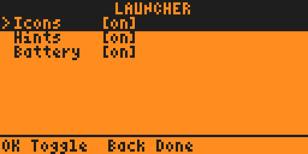

# The launcher

The launcher is the main screen: the list of apps you see after the boot screen, and where you
come back to when an app ends. It is also the **desktop** (spec K.6): its pages sit in a row,

```
SETTINGS  <-  APPS  ->  HOME  ->  NOTES  ->  RUNNING
```

and Left/Right move along it. APPS, the app list, is the page you start on. HOME, NOTES (the
notifications) and RUNNING are described in [Desktop and modules](desktop.md).


## The app list

- **Up/Down** choose an app, **OK** starts it. Back (long, in any app) ends the app and brings
  you back here.
- The black title bar is the **status line**: on the left the battery (its level, the charge in
  percent and a bolt while it charges), in the middle the page's name, on the right the time,
  the number of unread notifications (`*2`), a module's short status and the position of the
  chosen app, e.g. `3/12`, as far as they fit, in that order.
- The line at the bottom says what the buttons do on this screen: `<Settings OK Run >Home`.
- With more apps than fit (8 rows), a thin line on the right edge shows which part of the list
  you see.
- Short notices, such as `unknown user` or `app crashed`, appear on the bottom line for 2
  seconds instead of covering the screen. The list stays visible.

**Left** opens **SETTINGS**, the system settings, **Right** the **HOME** page. Left and Right
count only as a short press on their own, when you let go: holding Left+Up to turn off the
backlight (see [Buttons and gestures](buttons.md)) does not turn the page.

## HOME and modules

HOME shows the **tiles** of the desktop's modules: small programs, often shell scripts, that
put one line each on this page, such as the battery or the next bus. Up/Down move the bar,
Left goes back to APPS, Right to NOTES. With no module running it says `no tiles`. Writing a
module: [Desktop and modules](desktop.md).

A module writes its lines with the `guimod` command:

```
guimod tile NAME TEXT ...      set or change the module's tile
guimod status NAME TEXT ...    a short text (6 characters) on the status line
guimod notify NAME TEXT ...    a notification: on the NOTES page, counted on the status line
guimod close NAME              its tile and status go
```

The example module `/usr/share/examples/gui/battile.sh` (package `gmdemo`) is a battery tile
in three lines:

```
IFS='= '
while read key soc rest </dev/power
do guimod tile battery "Battery $soc%"; sleep 60; done
```

Start it with `sh /usr/share/examples/gui/battile.sh &`. When the module ends or is killed,
its tile goes (at the next key, or within a minute while HOME is shown). A module is your user
plus its name, so it can change only its own tiles; at most 16 tiles and statuses together.

A notification shows its text on the bottom line for 2 seconds, counts on the status line
(`*1`) until you open it, and stays on the NOTES page (the last 8) until you clear it there.

**When the screen is redrawn.** Only when something changes: a key, a record from a module
that changes what is shown, and the minute of the clock. With the light off, or while an app is
open, the launcher does not wake up at all; the time disappears from the title bar while the
light is off and comes back with the next key. Records sent while a full-screen app is open wait
in `/var/run/gui` (up to 7 KB) and are shown when you come back; `guimod` never waits for them.


## SETTINGS

The page lists the groups of settings: Display, Sound, LED, Time, Power, Storage, Gestures,
Launcher and About. OK opens one, Back returns to the app list. The ones marked `(later)` are
not there yet; Power opens today's Power app.

**Display**, **Sound**, **Time** and **About** are window apps (the `setgroup` program): the
launcher draws their screens in its own style, so they look like every other list. Up/Down
choose a line, Left/Right change its value, which takes effect at once, OK on a date or time
starts editing it (Left/Right choose the field, Up/Down change it, OK ends), Back leaves.

| Group | Line | Values |
|---|---|---|
| Display | Brightness | 10-100 % |
| | Timeout | the light goes off after 5 s ... 5 min without a key, or never |
| | Light | auto (the timeout), off or on: the forced modes of the button gestures; not kept over a restart |
| Sound | Volume | 0-100 %, the volume of every program that does not set its own (alarms set theirs) |
| | Test beep | OK plays three notes |
| Time | Date | the local date; when the edit ends (OK) the clock moves to it at once and keeps the time of day (years up to 2099, as the clock chip counts) |
| | Time | the local time of day (hours, minutes); when the edit ends the clock is set at once, with the seconds at 0 |
| | Zone | the time zone: OK opens a list of about 80 places (`UTC`, `Europe/Warsaw`, `America/New_York`, ...), starting at the current one (`*`); OK chooses one. `other` is a zone you wrote into `/etc/TZ` yourself, kept as it is |
| | Clock | 24 h or 12 h, for the clock apps |
| About | Base | the version of the base package |
| | ABI | the version of the program format (spec J.3) |
| | Kernel | the system image's version and build id, as `ver` prints it |
| | Free RAM | free memory and the largest free block, as `free` |
| | libc, libfuri | the shared libraries in flash: their size and the RAM each program needs for them (`free -v`) |
| | Serial | the chip's 64-bit unique id |
| | Licence | GPLv3; the MINIX base is BSD-3 |

The values are kept in `/etc/flipper/display.conf`, `sound.conf` and `time.conf` on the SD card,
written once when you leave the screen and only if something changed, and applied at every start
(`settings apply` in `/etc/rc`). Deleting a file brings the defaults back (100 %, 15 s, 100 %,
24 h). Opening a screen and leaving it without a change writes no settings to the card. (The
two pipes between the launcher and a window app still cost one inode on the card's root file
system for now, about 3 KB of writes at the next sync; a coming file-system change takes that
away.) The screens open only from the SETTINGS page: `setgroup` talks to the launcher, not to a
terminal. From the shell, edit the files and run `settings apply`.

The clock itself keeps UTC; the date and time on the Time screen are local time in the chosen
zone. A new zone is written to `/etc/TZ` when you leave the screen:

```
# Europe/Warsaw
CET-1CEST,M3.5.0,M10.5.0/3
```

Every program started after that (by INIT, the launcher or a new login) shows the new local time,
and the timers of `timed` are computed again; a shell that is already open keeps its old `TZ`
until you log in again. Zones whose rules the C library cannot express (Israel, Egypt, Chile,
Morocco) are not in the list: write their rule into `/etc/TZ` by hand if you need them.

While a settings screen is open it takes about 2.5 KB of RAM once its code runs from flash (the
system copies it there after it has been opened a few times): no screen buffer, no heap, 1.5 KB
of stack.

## The launcher's own settings



Launcher, on the SETTINGS page:

| Setting | What it does |
|---|---|
| Icons | the small pictures before the app names |
| Hints | the button line at the bottom and the position in the title bar |
| Battery | the battery on the title bar |
| Style | `pine` (the look above) or `stock` (the look of the stock firmware's menus, see [Stock style](#stock-style)) |
| Repeat | how fast a held Up or Down moves through a list: `off`, or a period of 350, 300, 250, 200, 152 (the default), 120 or 90 ms; the first step comes after 0.4 s. OK or Right: faster (and round from the fastest to `off`), Left: slower. It takes effect at once, on this same page |

Up/Down choose a setting (hold them to go on), OK (or Left/Right) switches it, Back returns to SETTINGS. The
settings are kept in `/etc/launcher.conf` on the SD card, which is written only when you go back
to the app list with something changed:

```
Icons: on
Hints: on
Battery: on
Style: pine
Repeat: 152
```

You can also edit that file from the shell; the launcher reads it again after the next app ends.
With all three off, the screen looks as it did before icons existed.

The battery value is read when the screen is redrawn, at most once a minute; the launcher never
wakes up only to update it.

## Stock style

With `Style: stock` the launcher looks like the stock firmware's menus. It is the same launcher
(one program, no restart): the same apps, keys, pages and settings; only the drawing changes.
Switch it on the launcher's settings page (SETTINGS, Launcher, `Style`): the page redraws at once,
and `/etc/launcher.conf` is written when you go back to the app list.

- **The app list** looks like the stock main menu: the app before, the selected app in a
  rounded frame in the bold font, the app after, a scroll bar on the right. There is no title bar
  and no hint line. Up/Down move (past the end it wraps), OK starts, Left/Right still change the
  page.
- **The other pages** (SETTINGS, the launcher's own settings, HOME) look like a stock submenu:
  the page name at the top, three rows, the selected one in a black rounded box.
- **Messages** ("not found", "unknown user", a notification) show in a small box over the list
  for 2 seconds or until the next key.
- **Apps follow the style.** The launcher starts each app with `FURI_STYLE=stock` or
  `FURI_STYLE=pine` in its environment, matching `Style:`, so apps built on libfuri draw their
  menus and dialogs in the same look.
- **Icons** are 10×10. The built-in `rfid`, `nfc`, `subghz`, `ir`, `ibutton`, `usb`, `file`,
  `settings`, `music` and `console` have the stock firmware's pictures; the other built-in icons
  and your own 8×6 ones are drawn in the middle of the cell. An app can bring a 10×10 icon of its
  own (the `##` form below).
- The text uses the two stock fonts (Helvetica Bold for the selected app, HaxrCorp 4089 for the
  rest).

The same three apps in the Pine style:

```
█████████████████████████████████████████████████████████▀██▀▀██▀▀███▀▀█████████████████████████████████████████████████████████
████████████████████████████████████████████████████████ ▀ █ ▀▄█ ▀▄█▄▀██████████████████████████████████████████████████████████
████████████████████████████████████████████████████████ █ █ ███ ███▀▀▄█████████████████████████████████████████████████████████
█▀████▀██████▀███▀▀█████▀████████▀▀█▀█▀█████████████████████████████████████████████████████████████████████████████████████████
██▄▀██ █ █▀ █ ██▄▀██ █ █ ▄▀█▀▀▀█ █▀█ ▀ █▄▄ █████████████████████████████████████████████████████████████████████████████████████
█▀▄█████▄▀▀▄████▀▀▄█▄▀ █ ▀▄█████▄▀ █ █ █▀ ▀█████████████████████████████████████████████████████████████████████████████████████
▀▀▀▀▀▀█▀▀▄ ▀█▀▀▀▀█▀▀▀█▀▀███▀▀▀▀▀█▀▀▀█▀█▀▀▀▀▀▀▀▀▀▀▀▀▀▀▀▀▀▀▀▀▀▀▀▀▀▀▀▀▀▀▀▀▀▀▀▀▀▀▀▀▀▀▀▀▀▀▀▀▀▀▀▀▀▀▀▀▀▀▀▀▀▀▀▀▀▀▀▀▀▀▀▀▀▀▀▀▀▀▀▀▀▀▀▀▀▀▀▀▀
       ▀▄█▄▀    ▀█  ▀ █ █▄      █▄▀ █▄█ ▀▀█
        █▄█     ▄█▄ ▄█▄ ▄▄▀     █ █ █ █ ▄█▄
       ▄▄  ▄      ▄ ▄▄▄  ▄
      █  █  █   █▄█ █▄  █ ▀
      █  █  █   █ ▀ █   ▀▄▀
       ▀▀  ▀
```

and in the Stock style:

```
                                                                                                                              ▀
                                                                                                                              ▀
       ▄      ▄                                                                                                               ▀
      █ ▄▀  ▀▄ █       ▄▄▄       ▄           ▄▄▄  ▄   ▄                                                                       ▀
      █ █ ██ █ █      █   ▀ ▄  ▄ █▄▄        █   ▀ █   █ ▄▄▄▄                                                                  ▀
      ▀▄  ▄▄  ▄▀       ▀▀▀▄ █  █ █  █ ▀▀▀▀▀ █  ▀█ █▀▀▀█  ▄▄▀                                                                  ▀
          ██          ▀▄▄▄▀ ▀▄▄█ █▄▄▀       ▀▄▄▄▀ █   █ █▄▄▄                                                                  ▀
          ▀▀                                                                                                                  ▀
                                                                                                                              ▀
                                                                                                                              ▀
  ▄▄▄▄▄▄▄▄▄▄▄▄▄▄▄▄▄▄▄▄▄▄▄▄▄▄▄▄▄▄▄▄▄▄▄▄▄▄▄▄▄▄▄▄▄▄▄▄▄▄▄▄▄▄▄▄▄▄▄▄▄▄▄▄▄▄▄▄▄▄▄▄▄▄▄▄▄▄▄▄▄▄▄▄▄▄▄▄▄▄▄▄▄▄▄▄▄▄▄▄▄▄▄▄▄▄▄▄▄▄▄▄▄▄▄▄▄▄▄▄   ▄█▄
▄▀                                                                                                                        █▄ ███
█                                                                                                                         ██ ███
█          ▄▄▄                                                                                                            ██ ███
█      ▄▄▄    ▀▄       ▄██  ▄█▀█▄ ██▀▀▀    ██    ██  ██                                                                   ██ ███
█     █ ▄ ▀▀▄  █        ██     ██ ██▄▄     ██▄█▀ ██▄▄██ ▀▀▀██                                                             ██ ███
█     ▀▄ ▄▀▄ █          ██   ▄█▀  ▄  ██    ███▄  ██  ██  ▄█▀                                                              ██ ███
█      ▀▄ ▀ ▄▀          ██  ██▄▄▄ ▀█▄█▀    ██ ▀█▄██  ██ ██▄▄▄                                                             ██ ███
█        ▀▀▀                                                                                                              ██ ███
█                                                                                                                         ██ ███
▀▄▄▄▄▄▄▄▄▄▄▄▄▄▄▄▄▄▄▄▄▄▄▄▄▄▄▄▄▄▄▄▄▄▄▄▄▄▄▄▄▄▄▄▄▄▄▄▄▄▄▄▄▄▄▄▄▄▄▄▄▄▄▄▄▄▄▄▄▄▄▄▄▄▄▄▄▄▄▄▄▄▄▄▄▄▄▄▄▄▄▄▄▄▄▄▄▄▄▄▄▄▄▄▄▄▄▄▄▄▄▄▄▄▄▄▄▄▄▄▄▄██ ███
  ▀▀▀▀▀▀▀▀▀▀▀▀▀▀▀▀▀▀▀▀▀▀▀▀▀▀▀▀▀▀▀▀▀▀▀▀▀▀▀▀▀▀▀▀▀▀▀▀▀▀▀▀▀▀▀▀▀▀▀▀▀▀▀▀▀▀▀▀▀▀▀▀▀▀▀▀▀▀▀▀▀▀▀▀▀▀▀▀▀▀▀▀▀▀▀▀▀▀▀▀▀▀▀▀▀▀▀▀▀▀▀▀▀▀▀▀▀▀▀▀▀   ▀
                                                                                                                              ▀
                                                                                                                              ▀
             ▄                                                                                                                ▀
       ▄   ▄  ▀▄      ▄   ▄ ▄▄▄▄▄  ▄▄▄                                                                                        ▀
      █▀▄   █  █      █▄  █ █     █   ▀                                                                                       ▀
      █  ▀▄▄▀  █      █ ▀▄█ █▀▀▀  █                                                                                           ▀
       ▀   ▀  ▄▀      █   █ █     ▀▄▄▄▀                                                                                       ▀
             ▀                                                                                                                ▀
                                                                                                                              ▀
                                                                                                                              ▀
```

A message in the Stock style:

```
                                                                                                                              ▀
                                                                                                                              ▀
       ▄      ▄                                                                                                               ▀
      █ ▄▀  ▀▄ █       ▄▄▄       ▄           ▄▄▄  ▄   ▄                                                                       ▀
      █ █ ██ █ █      █   ▀ ▄  ▄ █▄▄        █   ▀ █   █ ▄▄▄▄                                                                 ▄█▄
      ▀▄  ▄▄  ▄▀       ▀▀▀▄ █  █ █  █ ▀▀▀▀▀ █  ▀█ █▀▀▀█  ▄▄▀                                                                 ███
          ██          ▀▄▄▄▀ ▀▄▄█ █▄▄▀       ▀▄▄▄▀ █   █ █▄▄▄                                                                 ███
          ▀▀                 ▄▄▄▄▄▄▄▄▄▄▄▄▄▄▄▄▄▄▄▄▄▄▄▄▄▄▄▄▄▄▄▄▄▄▄▄▄▄▄▄▄▄▄▄▄▄▄▄▄▄▄▄▄▄▄▄▄▄▄▄▄▄▄▄▄▄▄▄▄                           ███
                            █▀                                                                   ▀█                          ███
                            █                                                                     █                           ▀
  ▄▄▄▄▄▄▄▄▄▄▄▄▄▄▄▄▄▄▄▄▄▄▄▄▄▄█                                                                     █▄▄▄▄▄▄▄▄▄▄▄▄▄▄▄▄▄▄▄▄▄▄▄    ▀
▄▀                          █                                                                     █                       █▄  ▀
█                           █                                                                     █                       ██  ▀
█          ▄▄▄              █                ▄                                                    █                       ██  ▀
█      ▄▄▄    ▀▄       ▄██  █      ▄  ▄ ▄▄▄  █  ▄ ▄▄▄   ▄▄  ▄  ▄  ▄ ▄▄▄    ▄  ▄  ▄▄  ▄▄  ▄▄▄      █                       ██  ▀
█     █ ▄ ▀▀▄  █        ██  █      █  █ █  █ █▄▀  █  █ █  █ █  █  █ █  █   █  █ ▀▄  █▄▄█ █        █                       ██  ▀
█     ▀▄ ▄▀▄ █          ██  █      ▀▄▄█ █  █ █ ▀▄ █  █ ▀▄▄▀ ▀▄▄▀▄▄▀ █  █   ▀▄▄█ ▄▄▀ ▀▄▄  █        █                       ██  ▀
█      ▀▄ ▀ ▄▀          ██  █                                                                     █                       ██  ▀
█        ▀▀▀                █                                                                     █                       ██  ▀
█                           █                                                                     █                       ██  ▀
▀▄▄▄▄▄▄▄▄▄▄▄▄▄▄▄▄▄▄▄▄▄▄▄▄▄▄▄█                                                                     █▄▄▄▄▄▄▄▄▄▄▄▄▄▄▄▄▄▄▄▄▄▄▄██  ▀
  ▀▀▀▀▀▀▀▀▀▀▀▀▀▀▀▀▀▀▀▀▀▀▀▀▀▀█                                                                     █▀▀▀▀▀▀▀▀▀▀▀▀▀▀▀▀▀▀▀▀▀▀▀▀   ▀
                            █▄                                                                   ▄█                           ▀
                             ▀▀▀▀▀▀▀▀▀▀▀▀▀▀▀▀▀▀▀▀▀▀▀▀▀▀▀▀▀▀▀▀▀▀▀▀▀▀▀▀▀▀▀▀▀▀▀▀▀▀▀▀▀▀▀▀▀▀▀▀▀▀▀▀▀▀▀▀▀                            ▀
             ▄                                                                                                                ▀
       ▄   ▄  ▀▄      ▄   ▄ ▄▄▄▄▄  ▄▄▄                                                                                        ▀
      █▀▄   █  █      █▄  █ █     █   ▀                                                                                       ▀
      █  ▀▄▄▀  █      █ ▀▄█ █▀▀▀  █                                                                                           ▀
       ▀   ▀  ▄▀      █   █ █     ▀▄▄▄▀                                                                                       ▀
             ▀                                                                                                                ▀
                                                                                                                              ▀
                                                                                                                              ▀
```

The Stock style has only been tested in QEMU so far. Nobody has checked yet how readable it is
on the Flipper's LCD.

## The list of apps: `/etc/apps`

One line per app:

```
Label:user:icon:/program arg ...
Label:user:/program arg ...          (no icon: the older form, still valid)
Label:user:icon:=/program arg ...    (a window app, see below)
```

The program must be an absolute path (starting with `/`). The app runs as `user`, in group `gui`.
With `=` before the program it is a **window app**: it runs as `user` in that user's own group
and never touches the screen.
The icon is one of:

- **empty** (`Label:user::/program`): no icon;
- **`@name`**: a built-in icon, e.g. `@bell`;
- **`#` and 12 hex digits**: your own 8×6 picture, one byte per row from the top, the left pixel
  in the highest bit, e.g. `#183C3C7E0018` (a small bell);
- **one or two characters**, drawn in the list font, e.g. `>_` or `Zz`;
- **`##` and 40 hex digits**: a 10×10 picture for the [Stock style](#stock-style), two bytes per
  row from the top, the left pixel in the highest bit (the low 6 bits of every second byte are
  unused), e.g. `##0700008070408C40A24089005500490022001C00`. The Pine style shows no icon for
  it, unless one of the forms above follows the 40 digits, e.g.
  `##0700008070408C40A24089005500490022001C00@rfid`. A package gives it with
  `mkpkg.py --icon10` (a 10×10 PNG, the `fap_icon` of a stock app, copied without downscaling).

A broken icon (an unknown name, bad hex digits, three characters) shows as no icon; the app
still starts.

The built-in icons:


`app`, `console`, `info`, `light`, `power`, `battery`, `rfid`, `nfc`, `subghz`, `ir`,
`ibutton`, `gpio`, `usb`, `ble`, `clock`, `alarm`, `bell`, `timer`, `sensor`, `game`,
`music`, `tools`, `file`, `settings`.

`/etc/apps` is read from the SD card, or from `/rom/etc/apps` if the card has none. Updating the
system adds icons to the base apps' lines as they were shipped; lines you changed stay as they
are.

Installing or removing a package that has a launcher line never rewrites `/etc/apps` in place:
its script writes the new list to `/etc/apps.new`, puts it on the card with `sync` and renames it
over `/etc/apps`. If the power goes off in the middle, the launcher has the old list or the new
one; a leftover `/etc/apps.new` can be deleted. If a script could not write the new list it says
so, and the package's line stays: delete it by hand.

## Window apps

Some apps do not draw on their own: they only describe their screens, and the launcher draws
them (spec K.8). Such an app needs no graphics code, so it takes about 4 KB of RAM while open
instead of about 15 KB. Its package says `Type: window`, and its line in `/etc/apps` has `=`
before the program. The example `gmdemo` package (`pkg install /lib/pkg/gmdemo_1.1.tar`) puts
**Demo** on the list.

A window app's screens look like the launcher's: the title bar, a selection bar, values in
brackets on the right and a hint line that names the buttons for the row under the cursor:

| Row | Buttons |
|---|---|
| an entry that opens something (`>` before it) | OK opens it |
| a number, a choice, on/off (`[40 %]`, `[rise]`, `[on]`) | Left/Right change it (OK too) |
| a time, a date, week days (`[07:30]`, `[2026-11-17]`, `[MTWTF--]`) | OK starts editing: Left/Right choose the part, Up/Down change it, OK ends |
| a text (`[Wake up]`) | OK opens the keyboard |
| a button row (`> Save`) | OK presses it |

- **The keyboard**: four rows of letters, digits and signs, then `Aa` (capitals), `Del`, `Spc`
  and `Done`. The arrows move, OK types the key under the cursor, `Done` keeps the text, Back
  leaves it as it was.
  In an app that types into a computer ([Teklatua](usb-gadgets.md)) every key goes out at once,
  so Back only closes the keyboard.
- **A pad** (Teklatua's mouse): a screen with a few lines of text where every button goes to
  the app, held or not; the hint line says `Keys go to the app  Back`. Back pressed alone and
  let go at once still leaves it.
- **Back** goes to the previous screen of the app at once, and on its first screen it closes the
  app. Back always works, even when the app does not answer.
- Values change on the screen at once. The app gets the changed values when you leave the screen
  or press a button row.
- When the app takes longer than 0.15 s to answer, a small hourglass appears on the right of the
  title bar; the screen still responds. An app that is still running 2 s after Back closed it is
  stopped (`SIGTERM`).
- Long lists are loaded a page (at most 16 rows) at a time; the title bar shows the position in the
  whole list, e.g. `17/40`.
- A **clock** screen shows the time in large digits and redraws once a minute while it is shown.
- **Opening a file in another app** (issue #413): a window app may send `run LABEL FILE`
  (`gm_run()`), as Archive's Open does. Its window ends, and the launcher starts the app of
  `/etc/apps` whose label is LABEL, as that line's user, with FILE (an absolute path) as its
  last argument. Only apps on the list can be started this way, and an app opened like this
  cannot open a further one. An unknown label shows `no such app`.

**Watching the traffic.** With `GuiLog: on` in `/etc/launcher.conf` the launcher copies every
record it gets from a window app (`gui< ...`) and every event it sends (`gui> ...`) to the
console. It is off when the line is missing, and the settings page keeps it as it is.

Writing a window app: the [Development Guide, chapter 7](../devguide/part1/07-desktop-modules.md).
