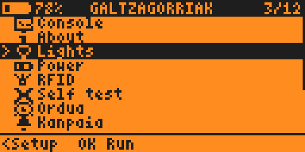

# The launcher

The launcher is the main screen: the list of apps you see after the boot screen, and where you
come back to when an app ends.



## The app list

- **Up/Down** choose an app, **OK** starts it. Back (long, in any app) ends the app and brings
  you back here.
- The black title bar shows, on the left, the battery: its level, the charge in percent and a
  bolt while it charges. On the right is the position of the chosen app, e.g. `3/12`.
- The line at the bottom says what the buttons do on this screen: `<Setup  OK Run`.
- With more apps than fit (8 rows), a thin line on the right edge shows which part of the list
  you see.
- Short notices, such as `unknown user` or `app crashed`, appear on the bottom line for 2
  seconds instead of covering the screen. The list stays visible.

**Left** opens **SETTINGS**, the system settings. Left counts only as a short press on its
own: holding Left+Up to turn off the backlight (see [Buttons and gestures](buttons.md)) does
not open them.

## SETTINGS

The page lists the groups of settings: Display, Sound, LED, Time, Power, Storage, Gestures,
Launcher and About. OK opens one, Back returns to the app list. The ones marked `(later)` are
not there yet; Power and About open today's Power and About apps.

**Display** and **Sound** are small screens of their own (the `settings` program): Up/Down choose
a line, Left/Right change its value, which takes effect at once, Back leaves.

| Group | Line | Values |
|---|---|---|
| Display | Brightness | 10-100 % |
| | Timeout | the light goes off after 5 s ... 5 min without a key, or never |
| | Light | auto (the timeout), off or on: the forced modes of the button gestures; not kept over a restart |
| Sound | Volume | 0-100 %, the volume of every program that does not set its own (alarms set theirs) |
| | Test beep | OK plays three notes |

The values are kept in `/etc/flipper/display.conf` and `sound.conf` on the SD card, written once
when you leave the screen and only if something changed, and applied at every start
(`settings apply` in `/etc/rc`). Deleting a file brings the defaults back (100 %, 15 s, 100 %).
From the shell: `settings display`, `settings sound`.

## The launcher's own settings


Launcher, on the SETTINGS page:

| Setting | What it does |
|---|---|
| Icons | the small pictures before the app names |
| Hints | the button line at the bottom and the position in the title bar |
| Battery | the battery on the title bar |

Up/Down choose a setting, OK (or Left/Right) switches it, Back returns to SETTINGS. The
settings are kept in `/etc/launcher.conf` on the SD card, which is written only when you go back
to the app list with something changed:

```
Icons: on
Hints: on
Battery: on
```

You can also edit that file from the shell; the launcher reads it again after the next app ends.
With all three off, the screen looks as it did before icons existed.

The battery value is read when the screen is redrawn, at most once a minute; the launcher never
wakes up only to update it.

## The list of apps: `/etc/apps`

One line per app:

```
Label:user:icon:/program arg ...
Label:user:/program arg ...          (no icon: the older form, still valid)
```

The program must be an absolute path (starting with `/`). The app runs as `user`, in group `gui`.
The icon is one of:

- **empty** (`Label:user::/program`): no icon;
- **`@name`**: a built-in icon, e.g. `@bell`;
- **`#` and 12 hex digits**: your own 8×6 picture, one byte per row from the top, the left pixel
  in the highest bit, e.g. `#183C3C7E0018` (a small bell);
- **one or two characters**, drawn in the list font, e.g. `>_` or `Zz`.

A broken icon (an unknown name, bad hex digits, three characters) shows as no icon; the app
still starts.

The built-in icons:


`app`, `console`, `info`, `light`, `power`, `battery`, `rfid`, `nfc`, `subghz`, `ir`,
`ibutton`, `gpio`, `usb`, `ble`, `clock`, `alarm`, `bell`, `timer`, `sensor`, `game`,
`music`, `tools`, `file`, `settings`.

`/etc/apps` is read from the SD card, or from `/rom/etc/apps` if the card has none. Updating the
system adds icons to the base apps' lines as they were shipped; lines you changed stay as they
are.
