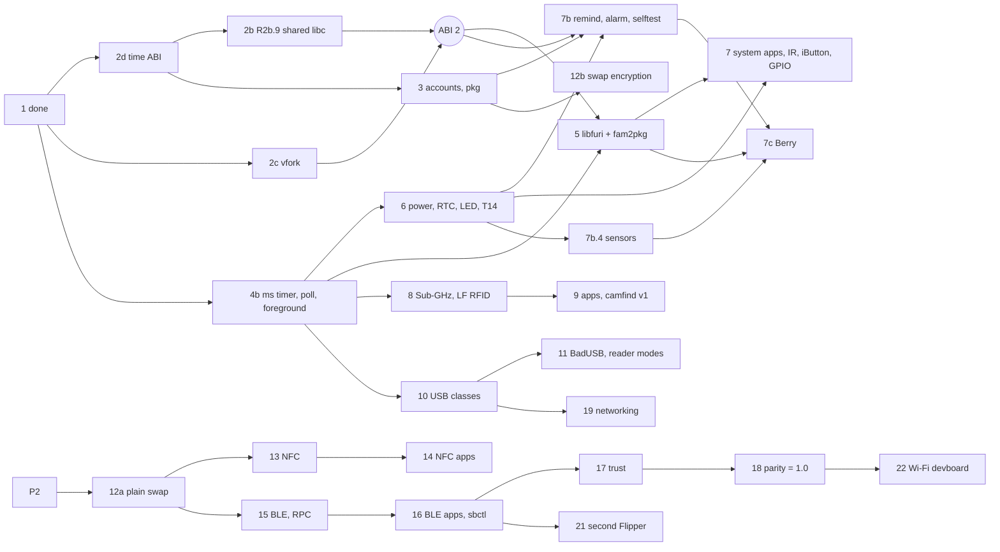

# Work strategy: from 0.1.1 to parity and beyond (2026-11-15)

User request (2026-11-15, 23:40 Warsaw): "plan a sensible work strategy to reach all the planned
goals". This file says **in what order** the phases of `galtzagorriak-spec.md` are done, **who**
does each part, **when a release is cut**, what can go wrong, and how fast we have really been
going. It changes no requirement; the spec stays the source of truth for *what* is built.

Goals it serves (user): feature parity with the stock firmware including its apps, and a useful
everyday gadget (reminders, alarm, camfind, sensors). Standing rules: responsiveness is a hard
criterion and wins over RAM; RAM is tight; few flash writes, above all at run time; don't rewrite
working MINIX core without need; docs follow behaviour; versioning per spec J.

---

## 1. Where we are (main @ `release: 0.1.1`, #94)

| Phase | State | Left to do |
|---|---|---|
| 1 Local-root holes | **done** (0.1.0) | — |
| 2a Static RAM | code merged (#23, −4864 B) | R2a.5 command `.bss` diet; AC2a.2 device figure; then close |
| 2b Flash-installed programs | most of it (#33 #37 #38 #44 #54 #55 #56, T11 #59 #72, L #64 #73) | **R2b.9 shared libc** (the big one), remaining ACs |
| 2c vfork | not started | R2c.1–R2c.3 |
| 2d Time ABI (64-bit `time_t`) | only I.1 minimal (#70) | R2d.1–R2d.9; must land before Phase 3 and 5 |
| 3 Accounts, packages | RNG only (R3.1, #4) | R3.2–R3.7 |
| 4a Cortex-M4 hardening | R4a.4 watchdog (#48), hsem (#52), R4a.9 umap (#14) | R4a.1–R4a.3, R4a.5–R4a.8 |
| 4b Driver platform | pulse engine for IR (#46), SD DMA (T4b #83 #84) | R4b.1–R4b.6, R4b.8 (ms timer, `poll()`, foreground ownership) |
| 6 Basic hardware | GPIO, vibro, speaker (#5), IR (#46), backlight (#81) | power/RTC/LED (R6.1, R6.2), power modes (T14a–d), iButton |
| 7b, 7c, 5, 8–22 | specified, not started | everything; pure-logic cores of `sbctl` (#35) and `camfind` (#75) exist |

Rough count: about **30 of ~290** requirement items are done (≈ 10 %). The foundation (phases 1–4)
is about 45 % done.

## 2. Measured pace (2026-11-14 14:25Z → 2026-11-15 22:40Z)

Source: the GitHub PR list (#1–#94) and `git log`.

| Measure | Value |
|---|---|
| PRs total | 94 (≈ 50 code PRs from the local agent, ≈ 44 spec/doc/CI PRs from review threads) |
| Code PRs merged | 45 of 50; #6/#7 superseded by #46 after changes were requested; #16–#18 duplicates closed unmerged |
| Agent's active hours | ≈ 22 h (two working days, a night pause 01:30–10:50Z) |
| Throughput | **≈ 2 merged code PRs per active hour**, ≈ 22–25 per working day |
| PR open → merge, median | ≈ 23 min (range 3 min – 2.5 h; #24 and #23 were the long ones) |
| Rework rate | **≈ 15 %**: 2 PRs superseded + 5 follow-up PRs for review findings (#40 #44 #49 #51 #53), plus 2 fixes pushed by review (#12, #40). 85 % merged on the first pass |
| Roadmap vs side work | ≈ 45 % of code PRs advanced a roadmap phase; ≈ 55 % were T-tasks (responsiveness, flash writes, editor, power) and user requests |
| PRs per phase item | Phase 1: 7 items → 5 PRs. 2a: 5 items → 1 PR (+R2a.5 open). 2b: 12 items → ≈ 12 PRs, not closed yet. **≈ 0.7–1.0 PR per requirement item**, rising for kernel and driver work |
| Spec growth | ≈ 40 spec PRs in 32 h added sections L and M, Phases 21 and 22, the power plan; requirements grew faster than they were closed |

Reading: implementation speed is not the bottleneck. **Ordering is**: half of the agent's output
went to work that is valuable but off the critical path, and the spec keeps growing.

## 3. Critical path and dependency graph

**Critical path to the first GUI gadget (7b):** 2d → R2b.9 → (ABI 2) → 3 → 7b, in parallel with
4b → 6 → 7b. The two branches meet at 7b; whichever is longer sets the date. Today the hardware
branch (4b → 6) is longer, because only the local agent can test it.

**Critical path to Berry (7c):** the 7b path plus Phase 5's GUI part (R5.1, R5.2) and 7b.4 sensors.
The Berry VM itself has no dependency and can be ported early (section 4).

**Critical path to 1.0 (Phase 18):** 12a (plain swap, for RAM headroom) → 15 (BLE on CPU2) → 16 → 17
→ 18. BLE is the longest single chain and the biggest unknown (R16.1.0 full stack on CPU2).

Rules this graph implies:
- **One ABI step.** 2d (64-bit `time_t`), R2b.9 (shared libc entry table) and 2c (`vfork` stub in
  libc) land together as ABI 2 (spec J.3 already asks for 2d + 2b in one step). Nothing that
  builds packages (Phase 3 `pkg` changes, Phase 5 `fam2pkg`, any app) is merged against ABI 1
  after the ABI-2 work starts.
- **4b before every new driver.** No new device driver (Sub-GHz, NFC, iButton, sensors) is merged
  before R4b.2 (ms timer), R4b.6 (`poll()`) and R4b.8 (foreground ownership); otherwise each driver
  invents its own timing and is reworked later.
- **Swap (12) before NFC and BLE.** Their RAM does not fit otherwise. Since 2026-11-16 (user)
  swap ships in two steps: plain swap as an option first (R12.28, needs only M1), encryption
  (12b) later. So the headroom arrives early and 12b is off the critical path.

## 4. Who does what: three lanes

| Lane | Who | Strength | Takes |
|---|---|---|---|
| **H** hardware | user's local agent | the only one with a Flipper; can measure current, latency, RF | kernel drivers, HAL, power, radios, anything with an on-device AC; device measurements for other lanes' PRs |
| **Q** QEMU/CI | CI Claude worker (GitHub Actions, issues labelled `claude-task`) | no hardware, unlimited QEMU and host tests | libc, MM/FS logic, commands, host tools, pure-logic cores of apps, tests, docs |
| **R** review | review threads (standing squash-merge authorization) | spec, cross-PR view | reviews, spec/next-tasks updates, release PRs, this strategy |

**Ownership by directory, to avoid merge conflicts between H and Q:**
- H owns `src/kernel/arm/`, `flipper/hal/`, the kernel device tasks, `flipper/m0/`, radio code.
- Q owns `src/lib/`, `src/commands/`, `src/mm/`, `src/fs/` logic, `flipper/tools/`, `flipper/tests/`,
  pure-logic app cores (`flipper/apps/*/core`), `docs/manual/`.
- A PR that must cross the line says so in its first line, and the other lane does not start a PR
  in the same files until it is merged.
- `flipper/ram-budget.txt` and `BASE_VER`: whoever merges second rebases and bumps (as today).

**Rules for the Q lane (issues for the CI worker):**
- An issue is a `claude-task` only if every acceptance criterion can be checked in QEMU or on the
  host. Device-only ACs are copied into the PR as "**device check for H**" and the PR may merge
  before them only if it is behind a flag or changes no default behaviour.
- Same gate as every PR: `build` green (images, `ramcheck`, QEMU `M2 USER PASS`).
- One issue = one spec item group = one PR, ≤ ~600 changed lines.

### Lane assignment for the next waves

| Item | Lane | Why |
|---|---|---|
| 2d time ABI (R2d.1–R2d.9) | **Q** | all ACs run in QEMU (AC2d.1–AC2d.5); RTC part already minimal (#70) |
| R2b.9 shared libc in flash | **Q**, device check by H | the installed region is emulated in QEMU (#56 power-cut tests); XIP speed checked on device |
| 2c vfork | **Q** | AC2c.1–AC2c.3 in QEMU; AC2c.R timing on device |
| R2a.5 command `.bss` diet | **Q** | pure userland; measured by `size` |
| 3 accounts, `pkg` hardening | **Q** | userland and FS |
| 4a remaining (R4a.1–3, 5–8) | **H** (R4a.5 ECC with option bytes: H only) | MPU and fault behaviour differ in QEMU |
| 4b ms timer, `poll()`, foreground | **H** (`poll()` core in MM/FS: Q, after H's timer lands) | LPTIM1, Stop2 |
| T14a–d, T15 power | **H** | current measurement |
| 6 RTC, LED, power, iButton | **H** | hardware |
| 5 `libfuri` core + GUI (R5.1, R5.2), `fam2pkg` (R5.5) | **Q** | canvas renders into a buffer, host-tested against reference images; `fam2pkg` is a host tool |
| 7b `remind`, `alarm` logic, `libapp` timers | **Q** core, **H** integration | scheduling logic host-testable; RTC wake and sound on device |
| 7b.3 `selftest` | **H** | it *is* hardware |
| 7c Berry VM port, memory limits, bindings skeleton | **Q**, start any time | VM is pure C; QEMU checks heap limits and the TSV protocol (spec K) |
| 7c bindings to sensors/radios | **H** | |
| 8, 9, 13, 14, 15, 16 drivers | **H** | radios |
| protocol decoders of stock apps (Sub-GHz, RFID, NFC, IR files) | **Q** | port from stock firmware (GPLv3 allowed), host-tested with captured files |
| CHANGELOG, manual chapters, man pages | **Q** with each PR; **R** at release | |

## 5. Order of work and releases

Version numbers follow spec J.1: the minor number goes up by one for each closed phase or
sub-phase, patch for task-only releases. A release PR is cut by R when a milestone closes, or
every ~2 working days with a patch release if no phase closed (as 0.1.1). The user pushes the tag.

| Milestone | Closes | Lanes in parallel | Version (approx.) | Done when |
|---|---|---|---|---|
| **M1 Foundation** | 2a, 2b, 2c, 2d | Q: 2d → R2b.9 → 2c, R2a.5. H: T14a, T14b (EXTI, tickless, Stop2), R4b.2 ms timer | **0.5.0, ABI 2** | every AC of 2a–2d passes; ABI 2 stamped; old cards upgrade (pkg path) |
| **M2 Platform** | 3, 4a, 4b | Q: Phase 3, `poll()` core, `libfuri` core (R5.1). H: 4b rest, 4a rest, T14c/d | 0.8.0 | drivers have timer/poll/foreground; `pkg` safe |
| **M3 First GUI gadget** | 6, 7b (`remind`, `alarm`, `selftest`), 12a+12e plain swap (R12.28) | Q: `libfuri` GUI (R5.2), `libapp`, `remind`/`alarm` cores, shared `libfuri` (#201), launcher look (T21–T22), the desktop (K.6, T23), T15 `power` app UI, plain swap in MM (may start in M2 when a Q slot is free). H: RTC wake, LED, sound, selftest | 0.10.0 | an alarm rings from Stop2 at the set minute; battery ≤ 1.5 mA idle |
| **M4 Apps and scripting** | 5, 7, 7b.4, 7c, 12d park/hibernate + Running list, 12h swappable blocks | Q: `fam2pkg`, launcher (R5.6) with Running list (R12.20), Berry VM + TSV modules, `blk`/`libblk`/`vbytes` (T20a). H: sensor drivers (section H), iButton | 0.14.0 | first stock apps ported; a Berry gadget runs ≤ 4 at once within L1–L10 |
| **M5 Radios I and USB** | 8, 9 (camfind v1 without Wi-Fi), 10, 11 | Q: protocol decoders, BadUSB parser, canary logic. H: CC1101, LF RFID, USB classes | ≈ 0.18 | stock Sub-GHz/RFID/BadUSB parity |
| **M6 Headroom and NFC** | 12b (swap encryption, then `crypt` by default), 13, 14 | Q: AES-GCM glue in MM, software GCM for QEMU, NFC protocol stacks. H: AES1 driver (R12.9), ST25R3916 driver | ≈ 0.22 | NFC apps run without OOM |
| **M7 Bluetooth** | 15, 16 (`sbctl`, `btbridge`, mobile app link R15.7) | Q: RPC protobuf (`libflipperpb`), GATT logic. H: CPU2 stack bring-up | ≈ 0.25 | phone app connects; `sbctl` drives the user's Venty |
| **M8 Trust and parity** | 17 (option bytes WRP/RDP1 after BLE), 18, 18b | Q: catalog, porting guide, wizard UI. H: U2F, updater, option bytes | **1.0.0** | Phase 18 ACs; rule 0.8 budgets met |
| M9 After parity | 19, 21, 22, then 20 continuous; **last:** F.3 `After: off` (T36a), then 12i hibernation (T36b) (user, 2026-11-19) | | 1.x | |

Within each milestone the H lane works in this priority: **(1)** anything the other lane is
waiting for (a device check, a timer API), **(2)** the milestone's critical-path item, **(3)**
responsiveness regressions, **(4)** user requests, **(5)** polish. T-tasks that are not on the
milestone's path wait for a gap instead of interleaving (this is the main change from the first
two days).

**Requirements closed (user, 2026-11-15 23:51 Warsaw):** the scope is the spec as merged at
#95. The lanes are in use from M1: issues #99–#104, tracking issue #105, rules in `next-tasks.md`
"Lanes and milestones".

**Scope gate (R lane):** new ideas from the user are welcome and still go into the spec at once,
but each one gets a milestone tag (M1–M9). Only ideas tagged with the current milestone become
next-tasks; the rest wait. This keeps the backlog growing without moving the critical path.

## 6. Forecast: first GUI (7b) and Berry (7c)

Method: remaining requirement items on each path × 0.7–1.0 PR per item × 1.15 for rework, divided
by the throughput that goes to the path. Assumptions: the agent keeps ≈ 11 active hours a day;
kernel and driver PRs are slower than so far, so H's roadmap throughput is taken as **8–12 PRs a
day** (half of today's total, because the rest stays for user requests); Q adds **6–10 PRs a
day** once the CI worker runs.

| Target | Items left on the path | PRs | With H alone | With H + Q in parallel |
|---|---|---|---|---|
| **M1 (ABI 2)** | ≈ 20 | 16–23 | 2–3 days | **1–2 days** |
| **First GUI gadget (M3, Phase 7b)** | ≈ 45 (M1 + 3 + 4b + 6 + 7b) | 36–52 | 4–6 days | **3–4 working days → about 2026-11-19 to 11-21** |
| **Berry modules (Phase 7c)** | + ≈ 25 (5 GUI, 7b.4, 7c) | + 20–29 | + 3 days | **+ 1–2 days → about 2026-11-21 to 11-24** (Berry VM ported early on Q) |
| Parity, 1.0 (Phase 18) | ≈ 200 | 160–230 | — | **4–8 weeks**, low confidence: BLE on CPU2 and NFC are the unknowns |

Confidence: medium for M1 and 7b (the work is like what has been done), low for 7c (Berry's RAM
footprint is unmeasured: if one VM does not fit 4 modules at once, 7c needs Phase 12 first and
moves after M6). The forecast is re-measured at each release and written into this file.

## 7. Risks

| # | Risk | Effect | Mitigation |
|---|---|---|---|
| 1 | **Single hardware lane.** Every device AC goes through one agent and one Flipper | H is the bottleneck for M3, M5–M8 | move everything testable to Q; H does device checks in batches; a second Flipper (Phase 21 target) would double it |
| 2 | **Scope growth** faster than delivery (≈ 40 spec PRs in 32 h) | critical path slips, spec gets stale | scope gate (section 5); milestone tags on every new section |
| 3 | **ABI churn** if packages are built before ABI 2 | rebuild of all packages, broken cards | ABI-2 rule in section 3; `pkg` refuses a wrong ABI (J.3) |
| 4 | **RAM** for Berry, NFC, BLE | features do not fit at once | swap (12) before 13/15; Berry measured early on Q; ramcheck budget per PR as now |
| 5 | **BLE on CPU2** (R16.1.0 full stack, FUS/stack updates) | longest chain to 1.0; a bricked radio core | do a CPU2 spike on H early in M2 (read stack version only, no FUS writes) to size the work |
| 6 | **Flash wear** from new features (settings, logs, swap metadata) | shorter device life | standing rule; each PR states its run-time writes; L and T11 budgets |
| 7 | **Merge conflicts** between H and Q | rework, reverts (seen with branch reuse) | directory ownership (section 4); always diff against `origin/main` before a PR |
| 8 | **Responsiveness regressions** from more background work | hard review criterion fails | `lat` before/after in every H PR; add a QEMU latency smoke test to CI (Q task) |
| 9 | **QEMU ≠ device** (MPU, flash timing, DMA) | Q PRs pass CI and fail on the Flipper | Q PRs list a "device check for H"; H runs the CI image weekly at least |
| 10 | **Wi-Fi devboard missing** | Phase 22 and camfind's Wi-Fi blocked | already deferred to the end (#78); nothing else depends on it |
| 11 | **Upstream stock code drift** while porting | ports go stale | pin one stock firmware release per milestone (D.2) |

## 8. Keeping this current

- R updates sections 1, 2 and 6 with each release PR (state table, pace, forecast).
- A milestone is closed only when its acceptance criteria pass; the release PR lists them.
- The final user/system manual grows with the PRs (`docs/manual/`); at M8 R writes the remaining
  chapters from the CHANGELOG and the spec's "notes for the system manual" sections.
